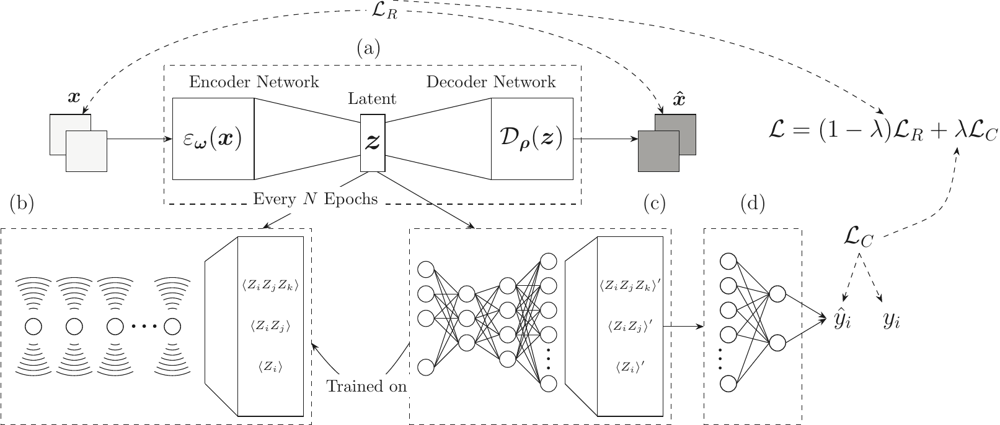

# QGARS: neutral-atom reservoir computing with a guided autoencoder

[](https://arxiv.org/abs/2605.06727)
[](https://doi.org/10.1109/QAI63978.2025.00064)
[](requirements.txt)
[](LICENSE)

Code for the paper *Medical Imaging Classification with Cold-Atom Reservoir
Computing using Auto-Encoders and Surrogate-Driven Training* (IEEE QAI 2025;
free on [arXiv](https://arxiv.org/abs/2605.06727)).

QGARS (Quantum Guided Autoencoder with Reservoir Surrogate) compresses each
image with an autoencoder, writes the latent code into the local detunings of
a simulated chain of Rydberg atoms, and classifies the measured correlations
with a linear classifier. Measurements block gradients, so a small neural
network (the surrogate) learns to imitate the reservoir, which lets the
classification loss train the encoder.



(a) Autoencoder. (b) Rydberg-atom reservoir. (c) Surrogate, retrained every
$N$ epochs on the reservoir's outputs. (d) Linear classifier.

## Main result

Test accuracy (%) of the linear classifier on the reservoir embeddings, with 12
atoms, mean ± standard deviation over five runs:

| Reduction before the reservoir | Synthetic polyps | CVC-ClinicDB | MNIST 0/1 |
|---|---|---|---|
| PCA | 79.20 ± 2.53 | 84.95 ± 2.31 | 97.70 ± 0.97 |
| Autoencoder | 77.50 ± 2.70 | 73.75 ± 1.90 | 87.05 ± 2.09 |
| QGARS (guided autoencoder) | **89.45 ± 2.06** | **88.90 ± 1.65** | 97.00 ± 2.37 |

Guiding the autoencoder through the surrogate gives the best reservoir
features on both polyp datasets. Against fully classical pipelines (PCA or an
autoencoder followed by a neural network) QGARS is ahead on synthetic polyps
(best classical 85.85) and behind on CVC-ClinicDB (91.65) and MNIST 0/1
(99.90).

## Method

### Guided autoencoder

The autoencoder is trained on

```math
\mathcal{L} = (1-\lambda)\,\mathcal{L}_R + \lambda\,\mathcal{L}_C
```

where $\mathcal{L}_R$ is the mean squared reconstruction error and
$\mathcal{L}_C$ the cross-entropy of a linear classifier applied to the
surrogate's output. Every $N$ epochs (`--quantum-update-frequency`) the
current latent codes are run through the simulated reservoir and the surrogate
is retrained on the result. $\lambda$ is `--guided-lambda`; $\lambda = 0$ is a
plain autoencoder.

### Rydberg reservoir

The latent code of $N$ values drives a chain of $N$ atoms under

```math
H(t) = \frac{\Omega(t)}{2}\sum_j \left(|g_j\rangle\langle r_j| + |r_j\rangle\langle g_j|\right) + \sum_{j < k} V_{jk}\, n_j n_k - \sum_j \left[\Delta_g(t) + \alpha_j \Delta_l(t)\right] n_j
```

with $n_j = |r_j\rangle\langle r_j|$, van der Waals couplings
$V_{jk} = C_6/\lVert \mathbf{r}_j - \mathbf{r}_k \rVert^6$, a global detuning
$\Delta_g$ and a local detuning $\Delta_l$ whose site weights $\alpha_j$ are the
latent code, scaled to the detuning range.

### Embeddings

At each of $T$ probe times the reservoir is measured to estimate

```math
\langle Z_i \rangle, \qquad \langle Z_i Z_j \rangle \;(i < j), \qquad \langle Z_i Z_j Z_k \rangle \;(i < j < k),
```

so the embedding has $T\left[N + \binom{N}{2} + \binom{N}{3}\right]$ values:
4768 for the paper's $N = 12$ atoms and $T = 16$ steps. `--readout-type`
selects `Z`, `ZZ` or `all`.

## Installation

Python 3.12, from the repository root:

```bash
pip install -r requirements.txt
```

The reservoir is simulated with [Bloqade](https://github.com/QuEraComputing/bloqade-analog)
on the CPU.

## Quick start

Reservoir embeddings for three random latent codes, without training (from the
repository root, e.g. in `python`):

```python
import numpy as np
from src.quantum_layer.qrc_layer import DetuningLayer

# A chain of 4 atoms probed at 4 times, reading out Z, ZZ and ZZZ correlators
reservoir = DetuningLayer(n_atoms=4, n_steps=4, readout_type="all")

codes = np.random.rand(4, 3)  # 3 latent codes, one value per atom
embeddings = reservoir.apply_layer(codes, n_shots=200)
print(embeddings.shape)       # (56, 3): 4 steps x (4 + 6 + 4) correlators
```

## Datasets

- **MNIST 0/1**: `--dataset-type binary_mnist`, downloaded on first use.
- **CVC-ClinicDB**: `python data/data_generation/CVC_Clinic_DB_Download.py`
  downloads the dataset from Kaggle. Put it in `data/datasets/cvc_clinic_db_original`
  and run `python data/data_generation/polyp_patch_extraction.py`, which writes
  the patches to `data/datasets/cvc_clinic_db_patches`.
- **Synthetic polyps**: `python data/data_generation/polyp_image_generation.py`
  (`--num-images`, default 6435) writes `dataset/polyp` and `dataset/no_polyp`
  in the current directory; move them to `data/datasets/generated_polyp_dataset`.

Image-folder datasets live in `data/datasets/<name>/<class>/` and are selected
with `--dataset-type <name>`.

## Running

One run trains the reduction, simulates the reservoir and trains three
classifiers: linear on the reduced features, linear on the reservoir embeddings
(`QRC`) and a small neural network on the reduced features (`NN`).

```bash
python -m src.main --dataset-type binary_mnist --reduction-method guided_autoencoder \
    --dim-reduction 12 --num-examples 2000 --num-test-examples 400
```

`--reduction-method` is `pca`, `autoencoder` or `guided_autoencoder`.
`python -m src.main --help` lists every option; the defaults are in
`src/utils/config_manager.py`. Results go to `results/`.

## Reproducing the paper

**Note.** The IEEE version of the paper (and arXiv v1) lists the Rabi
frequency as $\Omega = \pi$. The reported runs used the code default,
$\Omega = 2\pi$ rad/µs (`--rabi-freq`).

Sweeps are defined as profiles in `parameter_sweep/run_experiments.py`:

```bash
python parameter_sweep/run_experiments.py list
python parameter_sweep/run_experiments.py profile ae_pca_qgars_5_runs
```

| Result | Profile | Plot |
|---|---|---|
| Main table and classical baselines (five seeds) | `ae_pca_qgars_5_runs`, with `dataset_type` set per dataset | |
| Accuracy against the number of atoms | `encoding_dimensions` | `n_qubit_reduction_method_analysis.py` |
| Effect of $\lambda$ | `guided_autoencoder_lambda` | `guided_lambda_analysis.py` |
| Training losses | | `classical_qrc_losses_plotter.py` |
| Surrogate update frequency | `guided_autoencoder_update_frequency` | `quantum_update_frequency_analysis.py` |
| Choice of autoencoder weight decay | `autoencoder_regularization` | `autoencoder_regularization_analysis.py` |

A sweep writes `results/sweep/<profile>/<profile>_<timestamp>/all_results.csv`.
The plot scripts are in `parameter_sweep/data_analysis_scripts/`; each takes
that file (the losses plotter takes a run's `classifier_metrics.json`) and
saves the figure next to it, e.g.

```bash
python parameter_sweep/data_analysis_scripts/guided_lambda_analysis.py \
    results/sweep/guided_autoencoder_lambda/<run>/all_results.csv
```

## Layout

```
src/quantum_layer/          Rydberg reservoir (Bloqade) and correlator readout
src/feature_reduction/      PCA, autoencoder, guided autoencoder, surrogate
src/classification_models/  linear and neural-network classifiers, training loop
src/data_processing/        dataset loading
src/utils/                  configuration, command line, statistics, plots
data/data_generation/       dataset download, synthetic polyps, patch extraction
parameter_sweep/            sweep profiles and analysis scripts
```

## Citation

```bibtex
@inproceedings{batista2025medical,
  title     = {Medical Imaging Classification with Cold-Atom Reservoir Computing Using Auto-Encoders and Surrogate-Driven Training},
  author    = {Batista, Nuno and Morgado, Ana and Ferraz, Oscar and Pratapsi, Sagar Silva and Lobo, Jorge and Falc{\~a}o, Gabriel},
  booktitle = {2025 IEEE International Conference on Quantum Artificial Intelligence (QAI)},
  pages     = {373--380},
  year      = {2025},
  doi       = {10.1109/QAI63978.2025.00064},
  eprint    = {2605.06727},
  archivePrefix = {arXiv}
}
```

## License

MIT (see `LICENSE`).
